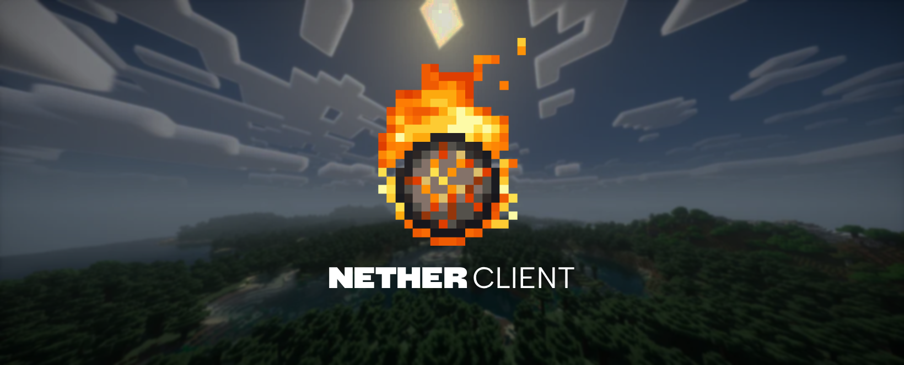
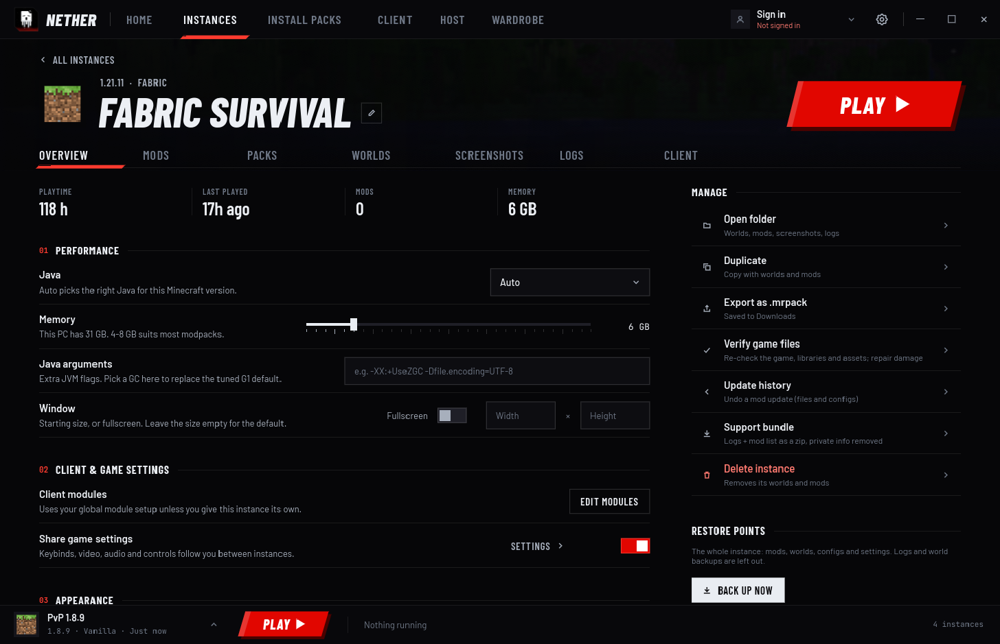
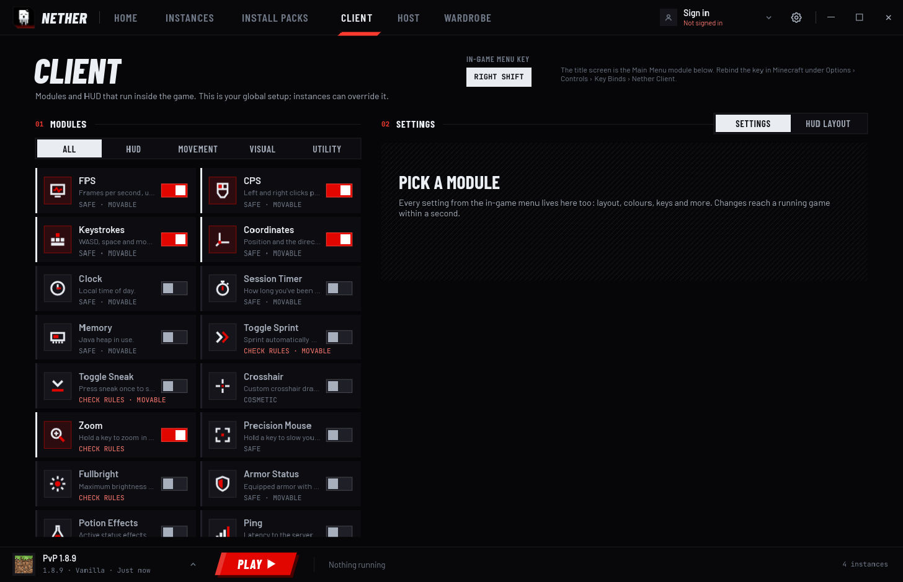
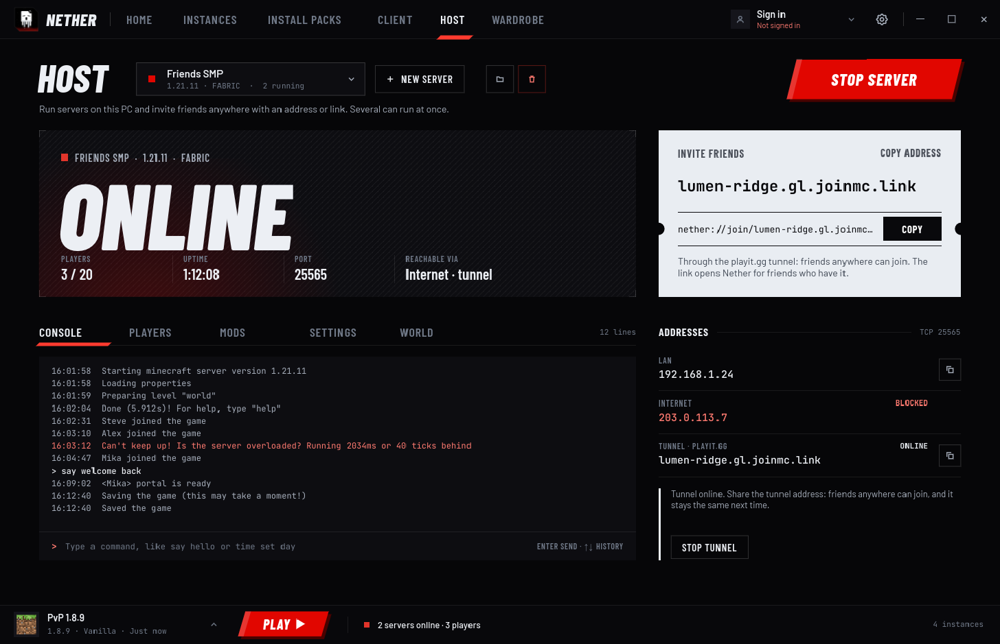
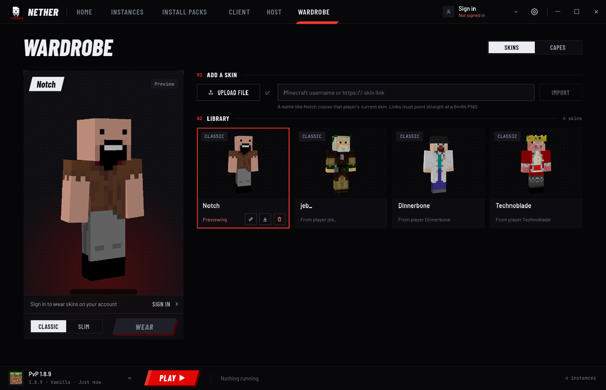
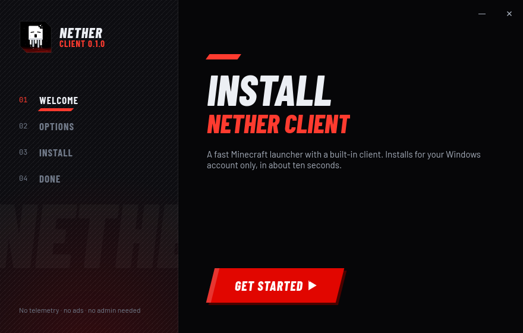

<p align="center"></p>

<p align="center"><b>A native Minecraft launcher with a built-in client, for every version from 1.8.9 to 26.x.</b><br>
Written in Rust (no Electron), with 33 in-game modules and a HUD you lay out yourself.<br>
Host a server for friends in one click. There's no telemetry, and updates install themselves.</p>

<p align="center">
  <a href="https://github.com/clapbxt/nether-client/releases/latest"><b>Download</b></a> ·
  <a href="#what-you-get">Features</a> ·
  <a href="SAFETY.md">Safety</a> ·
  <a href="PRIVACY.md">Privacy</a> ·
  <a href="https://github.com/clapbxt/nether-client/releases">Changelog</a> ·
  <a href="#development">Development</a>
</p>

<p align="center">
  <a href="https://github.com/clapbxt/nether-client/releases/latest"></a>
  <a href="https://github.com/clapbxt/nether-client/releases"></a>
  
  
  
</p>

<p align="center"></p>

## What you get

- **Native and fast.** Rust and Slint, with no web view. It's small, opens quickly and stays out of the way while you play.
- **Any version, any loader.** Vanilla, Fabric, Forge, NeoForge and Quilt, from 1.8.9 to 26.x.
  - Each instance is isolated, and the right Java (8, 17, 21 or 25) downloads by itself.
  - Imports `.mrpack`, CurseForge zips, and Prism and MultiMC instances.
- **Mods and modpacks from Modrinth.** One-click installs, filtered to your instance.
  - Updates take a snapshot first, so you can undo them.
  - A pre-launch check offers one-click fixes, and verify / repair restores broken game files.
- **A built-in client on every version, no mod needed.** 33 modules:
  - **HUD:** FPS with lows, frame graph, CPS, keystrokes, armor, potions, coordinates, compass, waypoints, vitals, item counter.
  - **PvP:** reach display and combo counter.
  - **Comfort:** zoom.
  - **Media:** media player for Spotify or your browser, with synced lyrics.
  - All of it opens on Right Shift.
- **A HUD you design.** Drag, snap, anchor, multi-select, undo. Every element has its own colours, outline and scale.
  - Profiles save whole layouts and share as a code.
- **A Nether main menu** on the title and pause screens: layouts, backgrounds, and quick-join for your servers. One click switches back to vanilla.
- **Safe by default.** No ESP, automation or anything that reads data the server didn't send you ([SAFETY.md](SAFETY.md)).
- **Host for friends.** Vanilla, Fabric or Paper servers in a few clicks, several at once. Plugins and mods come from Modrinth.
  - The launcher opens the port by itself (UPnP), or gives you a free tunnel address when your router won't.
  - Friends join from any launcher: **Multiplayer → Add Server**, then paste the address.
- **Wardrobe.** A skin library with a 3D preview, your Minecraft capes, and Nether capes that every Nether player sees.
- **Crash help.** A plain-English diagnosis with one-click fixes, and log sharing through mclo.gs.
- **Trust.**
  - Microsoft sign-in only. Your token goes to Microsoft and Mojang only, never to us.
  - No telemetry, no ads, and nothing paywalled.
  - Updates are signed and checked before they install.

<p align="center">
  
  
</p>
<p align="center">
  
  
</p>

## Download

Get **`NetherClientSetup-<version>.exe`** from the [latest release](https://github.com/clapbxt/nether-client/releases/latest) and run it.

- **Windows 10 or 11, 64-bit.** The setup installs for your Windows account only. It needs no admin rights and takes about ten seconds.
- **Updates are automatic.** New versions download in the background and are checked against our signing key. They install when you close the launcher, or right away with **Settings → Restart now**.
- **Windows SmartScreen** may say "Windows protected your PC" because the setup isn't code-signed yet. Choose **More info → Run anyway**. Every release also has a `.sig` file: the launcher's Ed25519 signature over the exact setup bytes.
- **To uninstall,** use **Settings → Apps → Installed apps → Nether Client**. Your instances and worlds stay in `%APPDATA%\NetherClient` unless you tick "Also delete my data".

<p align="center"></p>

## Versions

| | 1.8.9 | 1.20.2 – 1.21.11 | 26.x |
|---|:---:|:---:|:---:|
| Launch (Vanilla, Fabric, Forge, NeoForge, Quilt) | ✓ | ✓ | ✓ |
| Built-in client and HUD | ✓ | ✓ | ✓ |
| Nether main menu and pause button | ✓ | ✓ | ✓ |
| Nether capes and nametag icon | ✓ | ✓ | ✓ |
| Lyrics in the world, camera comfort | panel only | ✓ | ✓ |

Other versions launch normally. Client features that need a version's internals stay off there rather than break anything.

## Safety

Nether Client never touches the renderer, never sends packets for you and never reads anything the server didn't
send you. Sodium, Iris, Embeddium and Distant Horizons keep working untouched.

See **[SAFETY.md](SAFETY.md)** for the module-by-module table. If you run a server and want a module off, tell us in
[an issue](https://github.com/clapbxt/nether-client/issues).

## Privacy

There's no telemetry and no analytics. **[PRIVACY.md](PRIVACY.md)** lists every service the launcher and the client
talk to, and when.

## Help

- **The game won't start.** Open the instance and press **Play**. The pre-launch check lists problems with a fix button for each. After a crash, the crash page explains it and can share the log.
- **The in-game menu doesn't open.** Press **Right Shift**. The key can be changed in the Client page.
- **Something else.** Open [an issue](https://github.com/clapbxt/nether-client/issues) with **Settings → Support → Copy system info** pasted in. Your user folder and tokens are removed from it.

## Development

### Status

Beta, Windows 10/11 64-bit. Public builds ship to this repo's
[releases](https://github.com/clapbxt/nether-client/releases), and installed launchers update themselves.

### What's in it

- **Launcher** (`crates/app`, Slint). Its tabs:
  - **Home:** play, skin preview, news.
  - **Instances:** overview, mods, packs, worlds, screenshots, logs, client overrides.
  - **Install packs:** Modrinth.
  - **Client:** module settings shared with the game.
  - **Host:** local servers, invites, tunnel.
  - **Wardrobe:** skins, capes.
  - **Settings.**

  It also has a borderless window, a Ctrl+K command palette, toasts, a jobs list and a Reduce motion option.
- **Core** (`crates/core`): no UI.
  - **Accounts:** Microsoft device-code auth, several accounts, tokens in Credential Manager.
  - **Launching:** version and loader install (Vanilla, Fabric, Forge, NeoForge, Quilt), Java runtimes (8/17/21/25), the launch itself.
  - **Mods:** Modrinth, imports (`.mrpack`, CurseForge zip, Prism/MultiMC).
  - **Safety nets:** pre-launch check, verify/repair, snapshots before updates, restore points, crash analysis, mclo.gs.
  - **Hosting:** local servers (Vanilla/Fabric/Paper), UPnP, the playit tunnel, a plain address to share.
  - **Backend clients:** signed content, capes, auto-update.
- **In-game client** (`agent/`, Java 8+ agent, package `dev.nether.ov`): it injects into every loader and draws its own
  overlay (GL core/compat, LWJGL 2/3, SDL).
  - 33 modules.
  - The mod menu and HUD editor: anchors, snapping, multi-select, undo.
  - Profiles shareable as codes.
  - A Nether main menu.
  - Media player and lyrics.
  - Nether capes and nametag icon.
  - Server-safe and Auto Safe Mode.

  It never patches renderer classes (Rule 11): see [`agent/SAFETY.md`](agent/SAFETY.md).
- **Media helper** (`crates/media`): `nether-media.exe`. It reads Windows media controls (GSMTC) as line JSON over
  stdio and exits with the game.
- **Installer** (`crates/installer`): `NetherClientSetup.exe`.
  - A Slint wizard, per-user install, Apps & features entry, shortcuts and uninstall.
  - `--update` applies verified auto-updates.
- **Backend** (kept private, not in this repo): a Cloudflare Worker + D1 serving Ed25519-signed content (news, packs,
  capes, cosmetics) and players' capes and cosmetics. Auth uses Mojang's `join`/`hasJoined` handshake, so it never sees
  a Minecraft token.

### Known gaps

- Fabric 26.x and Forge/NeoForge client features are implemented from Mojang names but only partly verified in game.
- Discord Rich Presence stays hidden until a Discord application id is set.
- CurseForge browsing is hidden: it needs an approved API key.
- The setup isn't Authenticode-signed (SmartScreen warns). Updates are Ed25519-signed regardless.

### Building

Needs Rust stable (MSVC), Visual Studio Build Tools 2022 (C++ workload + Windows SDK), Node 18+, and a JDK 17+ for
the agent.

```powershell
powershell -File agent\build.ps1          # in-game client -> agent\build\*.jar + schema.json (embedded by core)
cargo build -p nether-app --release       # launcher; core's build.rs also builds and embeds nether-media.exe
cargo build -p nether-setup --release     # installer; embeds target\release\nether-app.exe
```

Order matters: the launcher embeds `agent/build`, and the setup embeds the launcher. `agent\build.ps1` needs the game's
LWJGL jars: launch Fabric 1.21.x, 1.8.9 and 26.3 once from the launcher first.

### Running

```powershell
cargo run -p nether-app --release
```

Developer switches live behind the `dev` cargo feature, never in shipping builds:

| What | How |
|---|---|
| Launcher screenshot | `cargo build -p nether-app --release --features dev`, then `target\release\nether-app.exe --snapshot out.png <tab> [inst] [instTab] [mode] [gate]` |
| Game without the launcher UI | `$env:NETHER_DEV_OFFLINE=1; cargo run -p nether-core --release --features dev --example launch -- 1.21.11 Player 60 fabric` (`NETHER_SNAPSHOT=<png>`, `NETHER_AGENT=<jar>`, agent dev props via `JAVA_TOOL_OPTIONS`) |
| Installer screens | `cargo build -p nether-setup --release --features dev`, then `NC_SETUP_SNAP="out.png|<mode>|<step>|<installed>"` |
| Installer end-to-end | `NC_SETUP_AUTO=install:<dir>` / `uninstall` (with `NC_SETUP_AUTO_OUT=<file>`) |

Tests: `cargo test -p nether-core` (the content tests need the private backend's content beside the repo).

### Releasing

Releases are built and signed with the maintainer's own tools and published to this repo's releases. Installed
launchers find the release and download it. They accept it only if GitHub's sha256 matches and the signature verifies
against `crates/core/res/release-ed25519.pub`, then install it when the launcher closes. Content (news, packs, capes,
cosmetics) is signed separately and checked against `crates/core/res/content-ed25519.pub`.

### Project layout

```
crates/
  app/          launcher: src/*.rs (one file per area), ui/*.slint (theme, components, one file per screen)
  core/         launcher logic, no UI; res/ = embedded public keys; examples/launch.rs = dev harness
  media/        nether-media.exe (GSMTC now-playing helper)
  installer/    NetherClientSetup.exe (wizard, uninstall, update applier)
agent/          in-game client (Java agent): src/dev/nether/agent (bootstrap, ASM hooks), src/dev/nether/ov (overlay,
                modules, menu, HUD editor); build.ps1; tools/names.js (mapping tables); SAFETY.md, NOTICE.md
design/         icon/ (logo sources) · module-icons/ (line icons, built into the agent)
```

### Adding a module

1. Create `agent/src/dev/nether/ov/<Name>.java` extending `Module`, with id, name, group, description, default
   on/off and HUD position. Then give it:
   - `Setting`s, each with a `hint` and a sane default (`bool`, `slider`, `choice`, `color`, `key`, `text`, `header`, `action`);
   - `safe()` if it is CHECK RULES;
   - `icon()` for its card.
2. Register it in the module list in `Modules.java`.
3. Read game state through `Data` / `Game` (null-safe: a missing field on a version hides the row, never crashes). Draw
   only through `Gfx`. Never patch renderer classes.
4. Run `agent\build.ps1`: the launcher's Client page picks the module up from `agent/build/schema.json` with no UI code.
5. Add a row to [SAFETY.md](SAFETY.md) and `agent/SAFETY.md`.

## Credits

Nether Client builds on great open work:

- the HUD auto-layout approach of [Velo Client](https://github.com/velo345/velo-client) (MIT)
- [Modrinth](https://modrinth.com) for mods
- [LRCLIB](https://lrclib.net) for lyrics
- [mclo.gs](https://mclo.gs) for log sharing
- [playit.gg](https://playit.gg) for tunnels
- [Slint](https://slint.dev) for the UI
- Barlow and JetBrains Mono (SIL OFL) for type

Licensed under the [MIT License](LICENSE). Third-party notices: [`agent/NOTICE.md`](agent/NOTICE.md) and
`crates/app/ui/fonts/OFL.txt`.

Nether Client is an independent project and not an official Minecraft product. It is not approved by or associated
with Mojang or Microsoft.
